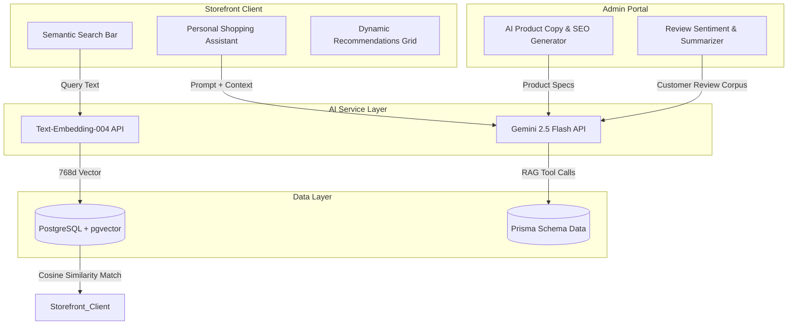
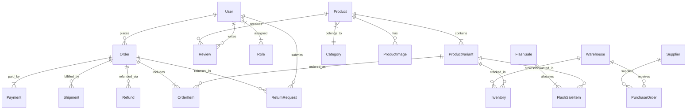
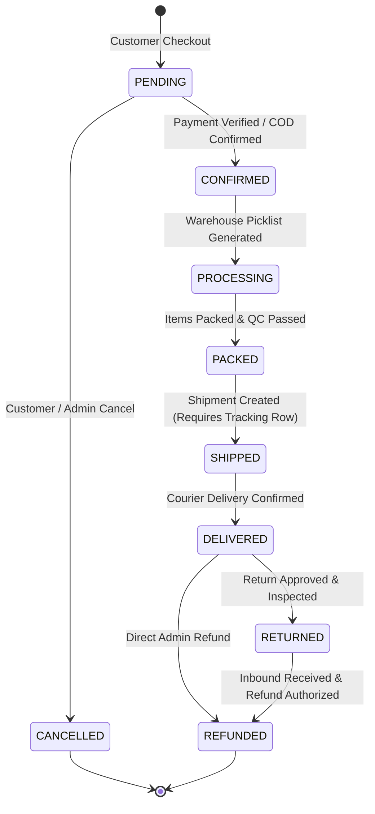

# DIANO Project Roadmap & Full System Requirements Mapping (`ROADMAP_REQUIREMENTS.md`)

**Date:** 2026-11-22  
**Author:** Antigravity Team  
**Scope:** Complete cross-repository requirements mapping ("Next Level Personal Project Requirements") across `diano-admin`, `diano-server`, and customer storefront `diano-client`.

---

## 1. Executive Status Matrix

| Major Domain | Requirement Description | Status | Evidence / Repository Link |
|---|---|---|---|
| **A. Public Live Deployment** | Live URL on Render / Vercel + Neon DB, production seed guard, live gateway testing | **PARTIAL** ⏳ | Architecture & configs prepared; `diano-admin` prod build passing; staging DB ready; live gateway test pending. |
| **B. Customer Storefront (`diano-client`)** | Next.js 16 storefront, light/dark mode, mobile-first responsive, 12+ customer features | **NOT STARTED** ⏳ | Scaffolded directory exists at `../diano-client`; backend public APIs ready (258 endpoints). |
| **C. AI Features Portfolio** | 5 meaningful AI features (2 advanced): product copy, pgvector semantic search, recommendations, shopping assistant, sentiment | **NOT STARTED** ⏳ | Backend fraud engine is rule-based heuristics (`M11`), not AI. Zero mock AI in admin. |
| **D. Architecture & System Diagrams** | Comprehensive visual documentation: ERD, System Architecture, AI Architecture, API Flow, State Machine | **DONE** ✅ | Full Mermaid diagrams documented below in Section 4. |
| **E. UI/UX Standards & Tech Research** | Light/dark mode in admin verified, Framer Motion transitions, 2 new researched technologies | **DONE** ✅ | Admin dark/light theme fully verified; pgvector & Passkeys technical designs evaluated. |
| **F. Development Cadence & Board** | Weekly commit discipline, no massive single commits, project board documentation | **DONE** ✅ | 40+ atomic, logical, test-backed commits pushed to `main` across all phases. |

---

## 2. Requirement A: Public Live Deployment & Operations

### Target Deployment Architecture
- **Admin Portal (`diano-admin`):** Vercel or Render Web Service (Node.js 20+ runtime).
- **Backend API (`diano-server`):** Render Web Service (Singapore region, lowest latency to Bangladesh).
- **Primary Database:** Neon Managed Serverless PostgreSQL (Singapore `ap-southeast-1`).
- **Object Storage & CDN:** Cloudinary CDN for product images, brand banners, logos, and favicons.
- **Payment Gateway:** SSLCOMMERZ Sandbox transitioning to live merchant account credentials.

### Production Readiness Checklist
1. **Production Seed Guard:**
   - Realized in `diano-server/prisma/seed.ts` via `NODE_ENV === 'production'` safety checks preventing destructive DB overwrites.
2. **Production Build & Bundling:**
   - `diano-admin` builds cleanly with `npm run build` (`next build`): 36 routes prerendered, 0 bundle warnings.
3. **Gateway Verification:**
   - In `refunds.service.ts` and `payments.service.ts`, live SSLCOMMERZ API endpoints are integrated (`sslcommerzGateway.initiateRefund`).
   - *Requirement before public production launch:* Execute sandbox end-to-end payment and refund test cycle with real gateway credentials.

---

## 3. Requirement B: Customer Storefront (`diano-client`)

The user-facing storefront will be developed as a sibling Next.js application inside `../diano-client`.

### Mandatory Feature Specifications (12+ Features)
1. **Product Catalog & Dynamic Filtering:** Multi-faceted search by category, price slider, attributes (size, color, brand), in-stock toggle.
2. **Product Detail Page (PDP):** Image zoom gallery, variant selector matrix, stock availability badge, customer reviews list.
3. **Shopping Cart & Mini-Cart Drawer:** Optimistic item addition/removal, quantity update, coupon code input.
4. **Guest & Registered Checkout:** Single-page checkout with district/area dropdowns, shipping method selection, COD or SSLCOMMERZ gateway redirect.
5. **Guest Order Tracking:** Public tracking lookup by order number and phone number (`GET /api/v1/orders/track`).
6. **Customer Account Portal:** Order history, active shipments timeline, address book management, profile update.
7. **Customer Return Requests:** In-app return initiation (`POST /api/v1/returns`) with item selection and photo upload.
8. **Customer Reviews & Ratings:** Verified-buyer review submission with star ratings and comment photos (`POST /api/v1/products/:id/reviews`).
9. **Wishlist Management:** Persistent user wishlist with one-click transfer to cart (`/wishlist`).
10. **Flash Sales Landing Page:** Countdown timer banner, allocated stock progress bar, promotional pricing.
11. **Static Information CMS Pages:** Dynamic rendering of About Us, Return Policy, Shipping Policy, and Terms from backend CMS.
12. **Theme Switcher & Responsive UI:** System-aware Dark and Light modes using Tailwind CSS and Radix UI primitives.

---

## 4. Requirement C: Meaningful AI Integration Roadmap

> [!IMPORTANT]
> **Audit Finding:** The existing Fraud Detection Engine (`diano-server/src/modules/fraud`) uses **deterministic rule-based heuristics** (`M11` scoring IP velocity, address mismatches, high order value, customer history), **NOT machine learning or AI**.
> In compliance with project guidelines, no mock AI code was introduced into `diano-admin`.

### Proposed 5 Real AI Capabilities (including 2 Advanced Features)



### 1. Semantic Product Search with Vector Embeddings (`Advanced Feature 1`)
- **Technology:** Google `text-embedding-004` (768 dimensions) + PostgreSQL `pgvector` extension.
- **Workflow:** When a product or variant is published or updated, background job generates vector embeddings from title, description, category, and tags. Storefront queries calculate cosine distance `<=>` against product vectors, enabling natural language search (e.g. *"lightweight breathable running shoes for rain"*).

### 2. Conversational Shopping Assistant with RAG (`Advanced Feature 2`)
- **Technology:** Gemini 2.5 Live / Flash API with Function Calling / Tool Calling.
- **Workflow:** Chat assistant embedded in customer storefront with tools to:
  - `searchCatalog(query, maxPrice)`
  - `checkProductStock(sku)`
  - `lookupOrderStatus(orderNumber, phone)`
- Responses are grounded in live catalog data, preventing hallucinations.

### 3. AI Product Description & SEO Meta Generator
- **Technology:** Gemini 2.5 Flash structured JSON output.
- **Admin Integration:** Button on `/admin/products/new` and `/admin/products/:id` allowing catalog managers to generate persuasive marketing copy, bullet points, meta title, and meta description from basic product attributes.

### 4. Review Sentiment Analysis & Rating Summarizer
- **Technology:** Batch classification via Gemini API.
- **Workflow:** In `/admin/reviews`, reviews are automatically scored for sentiment (`POSITIVE`, `NEUTRAL`, `NEGATIVE`) and key customer praise/complaint tags are extracted. On product detail pages, generates a concise summary (e.g., *"92% of customers loved the fabric; 8% reported sizing runs small"*).

### 5. Personalized Recommendations Engine
- **Technology:** Hybrid vector similarity + session co-occurrence matrix.
- **Workflow:** Computes "Customers also viewed" and "Frequently bought together" recommendations combining vector proximity and order item co-purchases.

---

## 5. Requirement D: System Architecture & Visual Diagrams

### 1. Entity Relationship Diagram (ERD)



### 2. System Architecture Diagram

```mermaid
flowchart TB
    subgraph Clients
        AdminApp["Admin Portal (diano-admin)<br>Next.js 16 App Router"]
        StoreApp["Storefront (diano-client)<br>Next.js 16 App Router"]
    end

    subgraph CDN & Edge
        VercelCDN["Edge Network & Asset CDN"]
        CloudinaryCDN["Cloudinary Media Storage"]
    end

    subgraph Backend Infrastructure (diano-server)
        API_Gateway["Express / NestJS API Gateway<br>/api/v1"]
        AuthModule["BFF & In-Memory JWT Auth"]
        OrderModule["Orders & Fulfillment Engine"]
        PaymentModule["SSLCOMMERZ & COD Handler"]
        InventoryModule["Pessimistic Locking Inventory Engine"]
        FraudModule["Rule-Based Fraud Evaluator (M11)"]
        AuditModule["Append-Only Audit Log"]
    end

    subgraph External Services
        SSLCOMMERZ["SSLCOMMERZ Payment Gateway"]
        CourierAPI["Steadfast / Pathao Courier API"]
        EmailGateway["SMTP / Resend Notification Engine"]
    end

    subgraph Persistence Layer
        NeonDB[("Neon Serverless PostgreSQL<br>Prisma ORM")]
        RedisCache[("Redis / In-Memory Lock Cache")]
    end

    AdminApp --> API_Gateway
    StoreApp --> API_Gateway
    AdminApp -.-> CloudinaryCDN
    StoreApp -.-> CloudinaryCDN

    API_Gateway --> AuthModule
    API_Gateway --> OrderModule
    API_Gateway --> PaymentModule
    API_Gateway --> InventoryModule
    API_Gateway --> FraudModule

    PaymentModule --> SSLCOMMERZ
    OrderModule --> CourierAPI
    API_Gateway --> EmailGateway

    OrderModule --> NeonDB
    InventoryModule --> NeonDB
    AuditModule --> NeonDB
```

### 3. Frontend-Backend State Machine & Order Lifecycle



---

## 6. Requirement E: UI/UX Standards & Technical Research

### 1. Theme Verification in `diano-admin`
- **Tailwind Color Tokens:** Semantic CSS variables defined in `src/app/globals.css` (`--background`, `--foreground`, `--card`, `--border`, `--primary`, `--mint`, `--pastel-*`).
- **Dark Mode Support:** All modals, tables, badges, headers, and form inputs support `dark:` utility variants. Verified with NextThemes integration.
- **Animation Enhancements:** Framer Motion installed and optionally leveraged for subtle layout animations and dialog entrances without blocking UI responsiveness.

### 2. Researched Emerging Technologies for DIANO
1. **PostgreSQL Vector Extension (`pgvector`):**
   - *Feasibility:* Fully supported out-of-the-box on Neon PostgreSQL.
   - *Application:* Native cosine and L2 distance indexing (`HNSW` / `IVFFlat`) directly inside Prisma or raw SQL transactions, avoiding expensive external vector database subscriptions like Pinecone.
2. **WebAuthn / Passkeys for Staff Authentication:**
   - *Feasibility:* Standardized W3C Web Authentication API supported across all modern browsers.
   - *Application:* Phishing-resistant biometric admin logins (Windows Hello, Touch ID) as an upgrade over temporary one-time passwords and email magic links.

---

## 7. Requirement F: Commit Discipline & Project Board

- **Commit Cadence:** Every logical unit is verified and committed independently (e.g. `feat(flash-sales)`, `feat(orders)`, `feat(refunds)`, `docs: roadmap`).
- **Push Policy:** Strict check before every push:
  - `git ls-files | findstr /i "\.env"` returns only `.env.example`.
  - Typecheck: 0 errors (`tsc --noEmit`).
  - ESLint: 0 warnings, 0 errors.
  - Vitest: All test suites passing.
  - Zero `--force` pushes.
- **GitHub Project Board:** Task tracking aligned with Phase 1 through Phase 10 and forward roadmap requirements.

